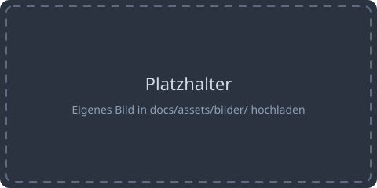

# F/A-26B

!!! warning "Vorlage / Beispielinhalt"
    Diese Seite ist eine **Vorlage**. Alle Werte mit `…` und alle als *Beispiel* markierten Inhalte sind Platzhalter und müssen durch echte Infos ersetzt werden.

{ width="480" }
/// caption
Hier ein eigenes Screenshot einfügen (Datei in `docs/assets/bilder/` hochladen).
///

## Steckbrief

| Eigenschaft     | Wert          |
| --------------- | ------------- |
| Rolle           | Mehrzweck     |
| Besatzung       | 1             |
| Verfügbarkeit   | Basisspiel    |
| Luftbetankung   | …             |
| Trägertauglich  | …             |

## Standard-Loadouts der Squadron

=== "Luft-Luft"

    | Station | Waffe | Anzahl |
    | ------- | ----- | ------ |
    | …       | …     | …      |

    *Beispiel, bitte durch euer echtes Loadout ersetzen.*

=== "Luft-Boden"

    | Station | Waffe | Anzahl |
    | ------- | ----- | ------ |
    | …       | …     | …      |

    *Beispiel, bitte durch euer echtes Loadout ersetzen.*

## Checkliste Kaltstart

- [ ] …
- [ ] …
- [ ] …

*Beispiel-Struktur, Schritte bitte eintragen.*

## Tipps

??? tip "Aufklappbarer Tipp (Beispiel)"
    Längere Erklärungen kann man so einklappen, damit die Seite übersichtlich bleibt.
