# Gegnerische Bodenziele

Alle gegnerischen Bodenziele in VTOL VR mit Bewaffnung, Reichweite, Bedrohung und RWR-Symbol. Die Bilder sind Kneeboard-Karten aus dem [VTOL-VR-Kneeboard](https://github.com/buschwacker/VTOL-VR-Kneeboard) von buschwacker (CC0).

**Legende:** 📡 Radar · 🔥 IR · 🔫 Rohrwaffe · ⚡ Sensor/EW · ➖ unbewaffnet · 💀 Bedrohungsstufe

!!! note "Werte mit (?)"
    Mit **(?)** markierte Werte sind nicht gesichert. Wer genauere Infos hat: gern ergänzen.

## Übersicht { #uebersicht }

**Radar-SAM-Systeme**

| Ziel | Typ / Reichweite | Bedrohung | RWR |
| ---- | ---------------- | --------- | --- |
| [MAD-4 SAM System](#mad-4-sam-system) | 📡 55 km | 💀💀💀💀 | 4 |
| [S/A Radar SAM System](#s-a-radar-sam-system) | 📡 55 km | 💀💀💀 | DS |
| [SL-MRM SAM System](#sl-mrm-sam-system) | 📡 Medium | 💀💀💀 | SL |
| [Fire Control Radar (FCR)](#fire-control-radar-fcr) | 📡 35 km | 💀💀💀 | SR |
| [SAM Launcher (BSM/ASM/FLKM)](#sam-launcher-bsm-asm-flkm) | 📡 55 km | 💀💀💀💀 | M |

**Mobile & Kurzstrecken-Flugabwehr**

| Ziel | Typ / Reichweite | Bedrohung | RWR |
| ---- | ---------------- | --------- | --- |
| [SAAW](#saaw) | 📡🔫 8 km | 💀💀 | SA |
| [IRAPC](#irapc) | 🔥 5,5 km | 💀💀 | – (kein Radar) |
| [Infantry MANPADS](#infantry-manpads) | 🔥 4 km | 💀 | – (kein Radar) |
| [AAA (Z20x2 / CIWS)](#aaa-z20x2-ciws) | 📡🔫 2,5 km | 💀 | A |
| [IRMD Launcher](#irmd-launcher) | 🔥 11,5 km | 💀💀 | – (kein Radar) |

**Sensoren & EW**

| Ziel | Typ / Reichweite | Bedrohung | RWR |
| ---- | ---------------- | --------- | --- |
| [Early Warning Radar (EWR)](#early-warning-radar-ewr) | ⚡ 35 km | keine | EW |
| [GMWS – Missile Warning Truck](#gmws-missile-warning-truck) | ⚡ 4 km | keine | MW |
| [GECM – ECM Truck](#gecm-ecm-truck) | ⚡ 60 km | keine | – |
| [Decoy Radar Transmitter](#decoy-radar-transmitter) | ➖ | keine | beliebig |
| [Decoy Launcher](#decoy-launcher) | ➖ | keine | – |

**Bodentruppen**

| Ziel | Typ / Reichweite | Bedrohung | RWR |
| ---- | ---------------- | --------- | --- |
| [Tank (MBT2-E / M1)](#tank-mbt2-e-m1) | 🔫 1 km | 💀 | – |
| [Artillerie (MPA-155 / RAT)](#artillerie-mpa-155-rat) | 🔫 Boden | keine (für Luftfahrzeuge) | – |
| [Bunker A & B](#bunker-a-b) | 🔫 1 km | 💀 | – |

**Strukturen**

| Ziel | Typ / Reichweite | Bedrohung | RWR |
| ---- | ---------------- | --------- | --- |
| [Missile Silo](#missile-silo) | ➖ | keine | – |
| [Factory](#factory) | ➖ | keine | – |
| [Tent, Storage](#tent-storage) | ➖ | keine | – |

## Radar-SAM-Systeme

### MAD-4 SAM System { #mad-4-sam-system }

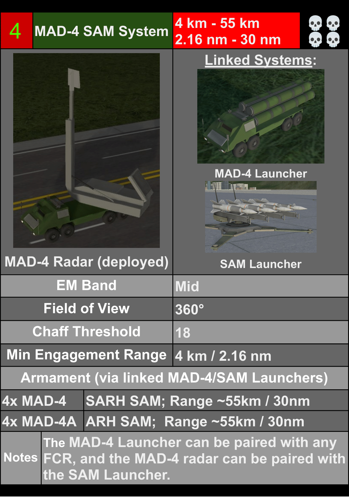{ loading=lazy }

- 📡 **Lenkung:** MAD-4 SARH / MAD-4A ARH (je 4x)
- 📏 **Reichweite:** 4–55 km (2.16–30 nm)
- 💀 **Bedrohung:** 💀💀💀💀
- 📻 **RWR:** 4 · **Band:** Mid · **FOV:** 360° · **Chaff:** 18

> MAD-4 Launcher mit jedem FCR koppelbar, MAD-4 Radar mit dem SAM Launcher. Min. Einsatzdistanz 4 km.

[⬆ Zur Übersicht](#uebersicht)

### S/A Radar SAM System { #s-a-radar-sam-system }

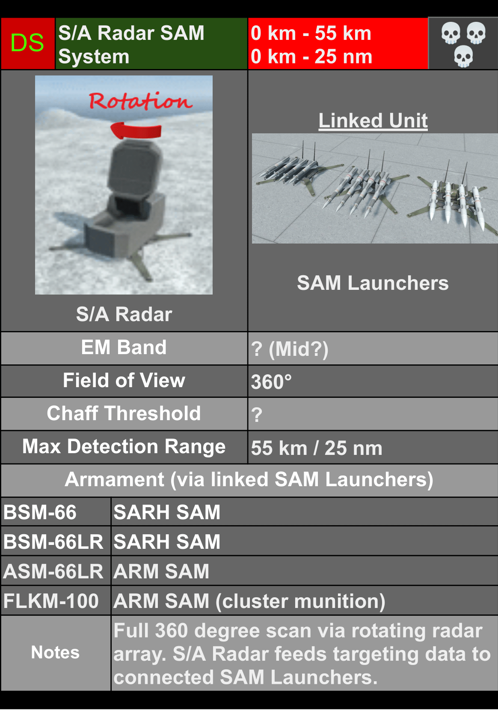{ loading=lazy }

- 📡 **Lenkung:** über SAM Launcher – BSM-66/-66LR SARH, ASM-66LR/FLKM-100 ARH
- 📏 **Reichweite:** 0–55 km (0–25 nm)
- 💀 **Bedrohung:** 💀💀💀
- 📻 **RWR:** DS · **Band:** Mid (?) · **FOV:** 360° · **Chaff:** ?

> Rotierendes Radar mit vollem 360°-Scan, liefert Zieldaten an verbundene SAM Launcher.

[⬆ Zur Übersicht](#uebersicht)

### SL-MRM SAM System { #sl-mrm-sam-system }

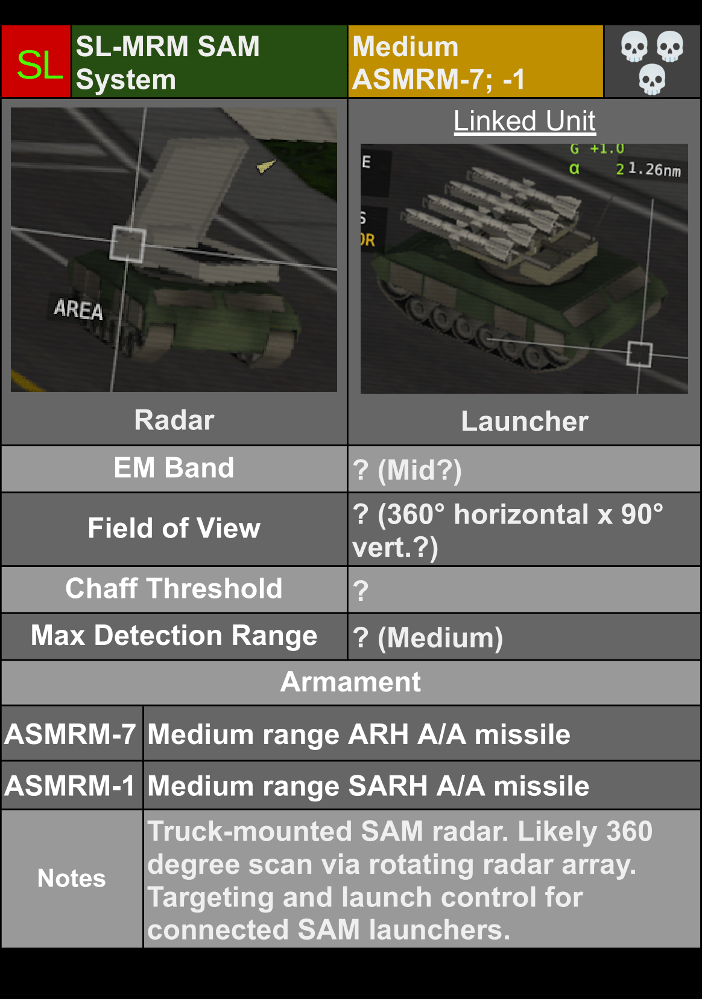{ loading=lazy }

- 📡 **Lenkung:** ASMRM-7 ARH / ASMRM-1 SARH
- 📏 **Reichweite:** Medium (genauer Wert unbekannt)
- 💀 **Bedrohung:** 💀💀💀
- 📻 **RWR:** SL · **Band:** Mid (?) · **FOV:** 360°×90° (?) · **Chaff:** ?

> Radarfahrzeug, vermutlich 360°-Scan per rotierendem Radar. Zielführung und Startkontrolle für verbundene Launcher.

[⬆ Zur Übersicht](#uebersicht)

### Fire Control Radar (FCR) { #fire-control-radar-fcr }

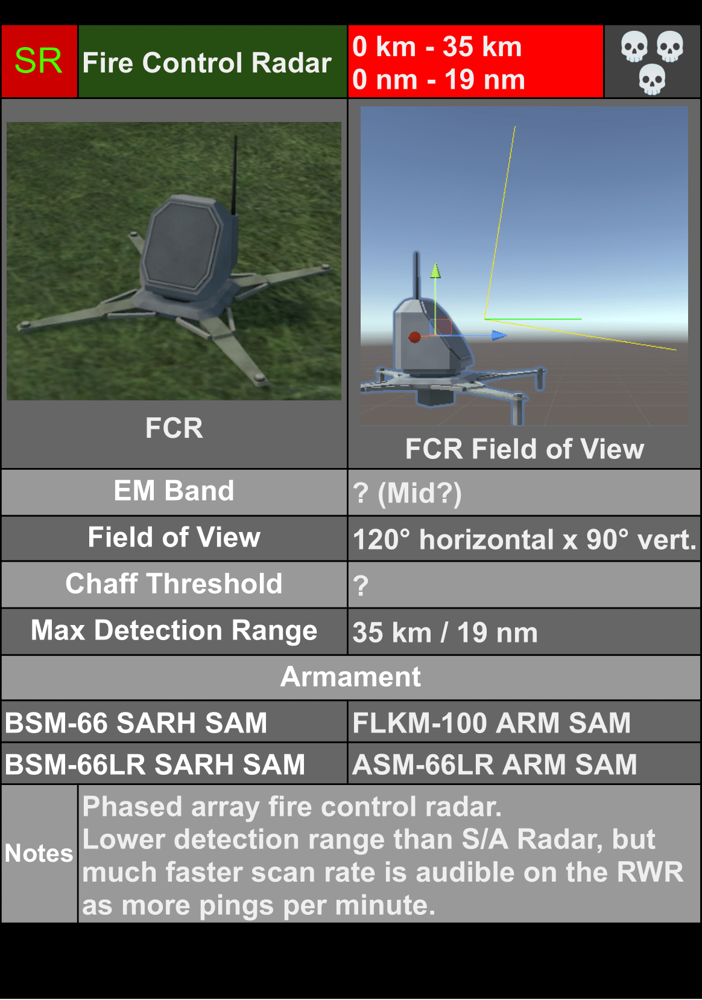{ loading=lazy }

- 📡 **Lenkung:** über SAM Launcher – BSM-66/-66LR SARH, ASM-66LR/FLKM-100 ARH
- 📏 **Reichweite:** 0–35 km (0–19 nm)
- 💀 **Bedrohung:** 💀💀💀
- 📻 **RWR:** SR · **Band:** Mid (?) · **FOV:** 120°×90° · **Chaff:** ?

> Phased-Array-Radar. Kürzere Reichweite als das S/A Radar, aber deutlich schnellere Scanrate, hörbar als mehr Pings pro Minute im RWR.

[⬆ Zur Übersicht](#uebersicht)

### SAM Launcher (BSM-66 / ASM-66LR / FLKM-100) { #sam-launcher-bsm-asm-flkm }

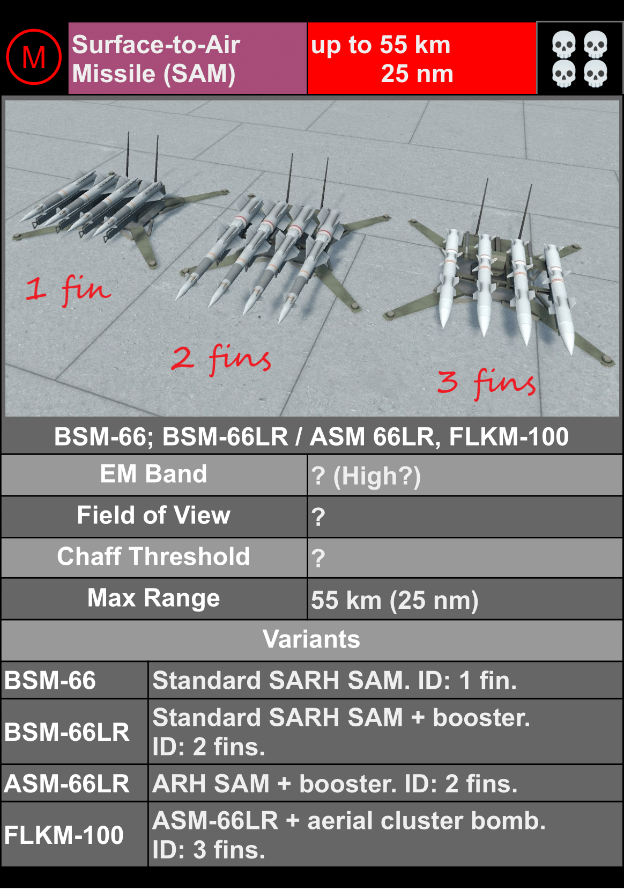{ loading=lazy }

- 📡 **Lenkung:** SARH oder ARH (je nach Variante)
- 📏 **Reichweite:** bis 55 km (25 nm)
- 💀 **Bedrohung:** 💀💀💀💀
- 📻 **RWR:** M · **Band:** High (?) · **FOV:** ? · **Chaff:** ?

> **BSM-66:** SARH – 1 Flosse
>
> **BSM-66LR:** SARH + Booster – 2 Flossen
>
> **ASM-66LR:** ARH + Booster – 2 Flossen
>
> **FLKM-100:** ASM-66LR + Streubombe – 3 Flossen

[⬆ Zur Übersicht](#uebersicht)

## Mobile & Kurzstrecken-Flugabwehr

### SAAW – Self-propelled Anti-Air Weapon { #saaw }

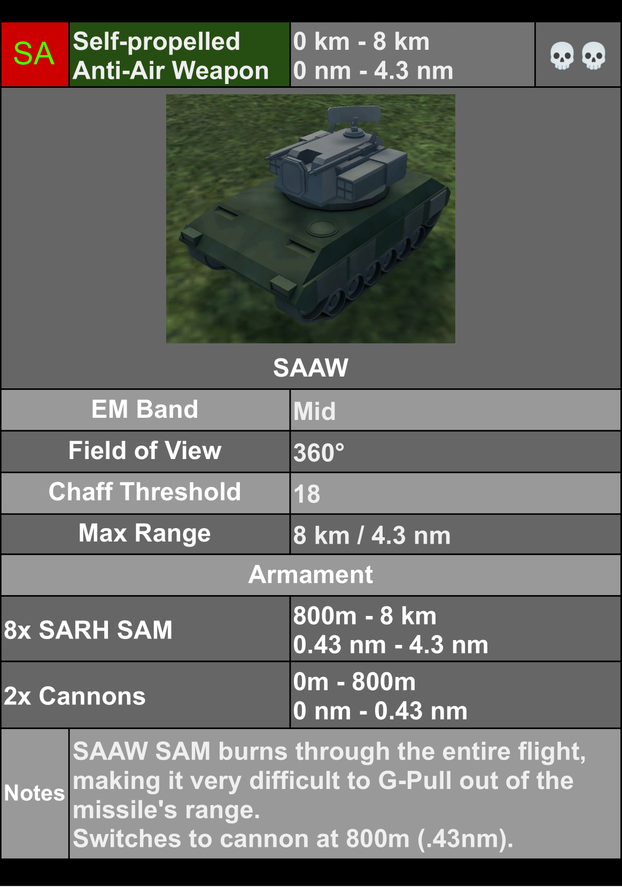{ loading=lazy }

- 📡🔫 **Lenkung:** 8x SARH SAM + 2x Kanone
- 📏 **Reichweite:** 0–8 km (0–4.3 nm)
- 💀 **Bedrohung:** 💀💀
- 📻 **RWR:** SA · **Band:** Mid · **FOV:** 360° · **Chaff:** 18

> SAM 800 m–8 km, darunter Kanone (0–800 m). Die Rakete brennt den ganzen Flug, man kann ihr kaum per G-Pull entkommen.

[⬆ Zur Übersicht](#uebersicht)

### IRAPC { #irapc }

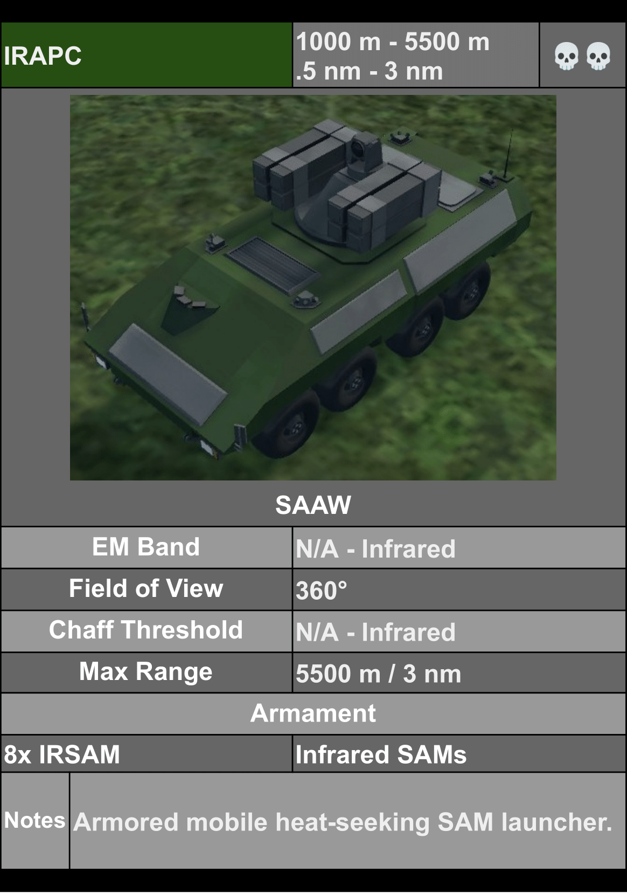{ loading=lazy }

- 🔥 **Lenkung:** 8x IR SAM
- 📏 **Reichweite:** 1–5,5 km (0.5–3 nm)
- 💀 **Bedrohung:** 💀💀
- 📻 **RWR:** – (kein Radar) · **FOV:** 360°

> Gepanzerter, mobiler IR-SAM-Werfer.

[⬆ Zur Übersicht](#uebersicht)

### Infantry MANPADS { #infantry-manpads }

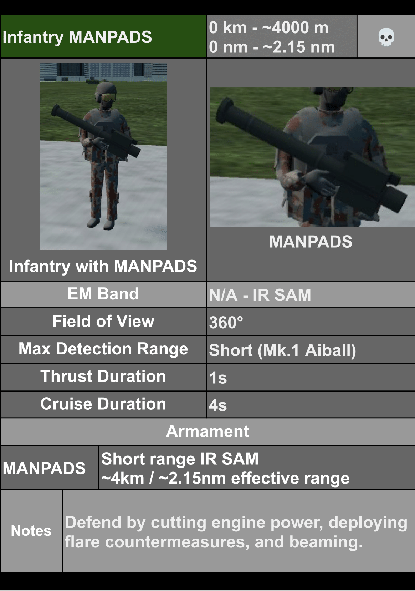{ loading=lazy }

- 🔥 **Lenkung:** IR SAM (Kurzstrecke)
- 📏 **Reichweite:** 0–~4 km (0–~2.15 nm)
- 💀 **Bedrohung:** 💀
- 📻 **RWR:** – (kein Radar) · **FOV:** 360° · **Erfassung:** Sicht

> Schub 1 s, Gleitflug 4 s. Abwehr: Leistung raus, Flares, beamen.

[⬆ Zur Übersicht](#uebersicht)

### AAA (Z20x2 / CIWS) { #aaa-z20x2-ciws }

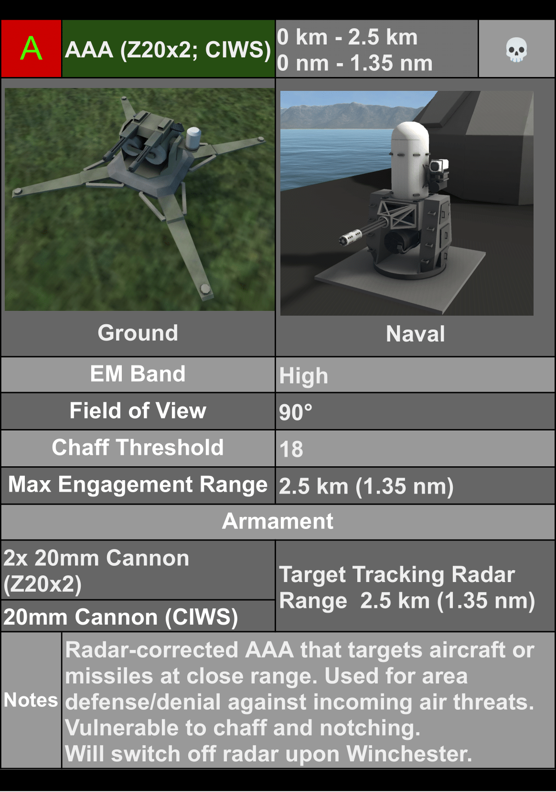{ loading=lazy }

- 📡🔫 **Lenkung:** Radargesteuerte 20-mm-Kanone
- 📏 **Reichweite:** 0–2,5 km (0–1.35 nm)
- 💀 **Bedrohung:** 💀
- 📻 **RWR:** A · **Band:** High · **FOV:** 90° · **Chaff:** 18

> Z20x2 an Land, CIWS auf Schiffen. Bekämpft Flugzeuge und Raketen auf kurze Distanz. Anfällig für Chaff und Notching, schaltet das Radar ab, wenn die Munition leer ist.

[⬆ Zur Übersicht](#uebersicht)

### IRMD Launcher { #irmd-launcher }

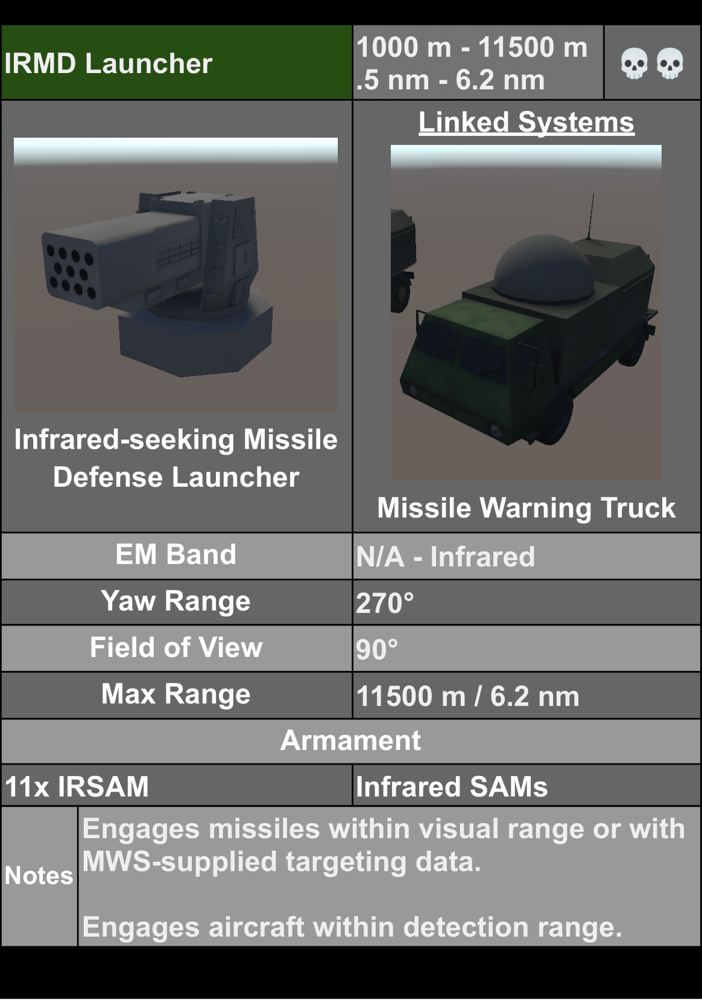{ loading=lazy }

- 🔥 **Lenkung:** 11x IR SAM
- 📏 **Reichweite:** 1–11,5 km (0.5–6.2 nm)
- 💀 **Bedrohung:** 💀💀
- 📻 **RWR:** – (kein Radar) · **Schwenkbereich:** 270° · **FOV:** 90°

> Bekämpft Raketen auf Sicht oder mit Daten vom Missile Warning Truck (GMWS), Flugzeuge innerhalb der Erfassungsreichweite.

[⬆ Zur Übersicht](#uebersicht)

## Sensoren & EW

### Early Warning Radar (EWR) { #early-warning-radar-ewr }

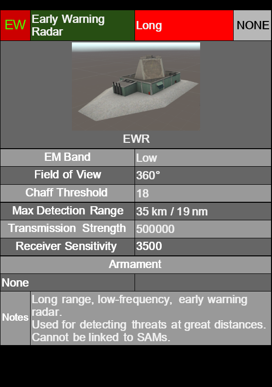{ loading=lazy }

- ⚡ **Lenkung:** – (unbewaffnet)
- 📏 **Erfassung:** 35 km (19 nm)
- 💀 **Bedrohung:** keine
- 📻 **RWR:** EW · **Band:** Low · **FOV:** 360° · **Chaff:** 18

> Langstrecken-Frühwarnradar. Nicht mit SAMs koppelbar. Sendeleistung 500000, Empfindlichkeit 3500.

[⬆ Zur Übersicht](#uebersicht)

### GMWS – Missile Warning Truck { #gmws-missile-warning-truck }

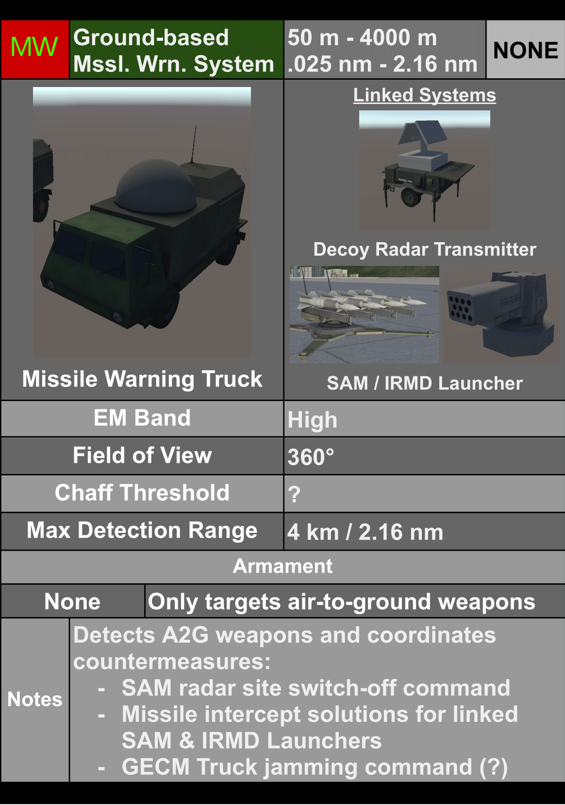{ loading=lazy }

- ⚡ **Lenkung:** – (unbewaffnet)
- 📏 **Erfassung:** 50 m–4 km (0.025–2.16 nm)
- 💀 **Bedrohung:** keine
- 📻 **RWR:** MW · **Band:** High · **FOV:** 360° · **Chaff:** ?

> Erkennt anfliegende Luft-Boden-Waffen und koordiniert die Abwehr: schaltet SAM-Radare ab, liefert Abfangdaten an SAM- und IRMD-Launcher, steuert evtl. GECM-Jamming (?). Koppelbar mit dem Decoy Radar Transmitter.

[⬆ Zur Übersicht](#uebersicht)

### GECM – Ground-based ECM Truck { #gecm-ecm-truck }

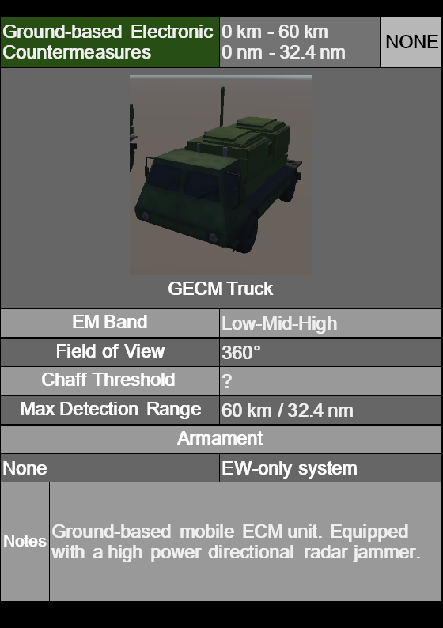{ loading=lazy }

- ⚡ **Lenkung:** – (Störsender)
- 📏 **Reichweite:** 0–60 km (0–32.4 nm)
- 💀 **Bedrohung:** keine
- 📻 **Band:** Low/Mid/High · **FOV:** 360° · **Chaff:** ?

> Mobiler ECM-Truck mit starkem, gerichtetem Radar-Jammer.

[⬆ Zur Übersicht](#uebersicht)

### Decoy Radar Transmitter { #decoy-radar-transmitter }

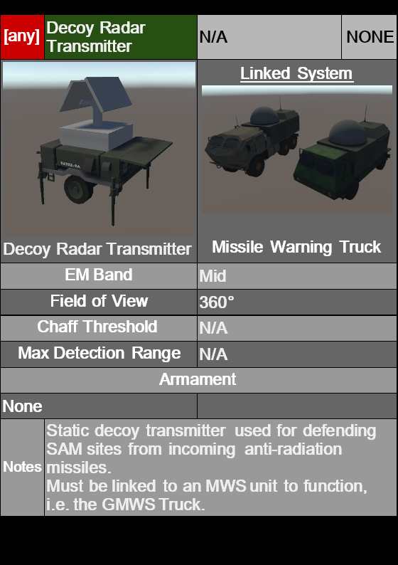{ loading=lazy }

- ➖ **Lenkung:** – (unbewaffnet)
- 💀 **Bedrohung:** keine
- 📻 **RWR:** beliebig · **Band:** Mid · **FOV:** 360°

> Statischer Köder-Sender, schützt SAM-Stellungen vor Anti-Radar-Raketen. Funktioniert nur mit verbundenem Missile Warning Truck (GMWS).

[⬆ Zur Übersicht](#uebersicht)

### Decoy Launcher { #decoy-launcher }

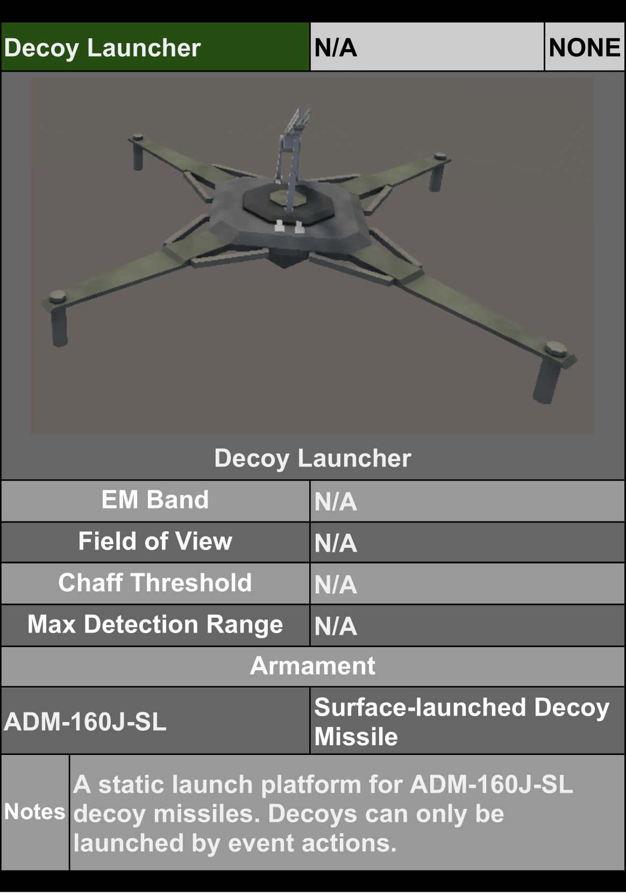{ loading=lazy }

- ➖ **Lenkung:** – (startet Köder-Raketen)
- 💀 **Bedrohung:** keine

> Statische Startplattform für ADM-160J-SL. Köder starten nur per Event-Action.

[⬆ Zur Übersicht](#uebersicht)

## Bodentruppen

### Tank (MBT2-E / M1) { #tank-mbt2-e-m1 }

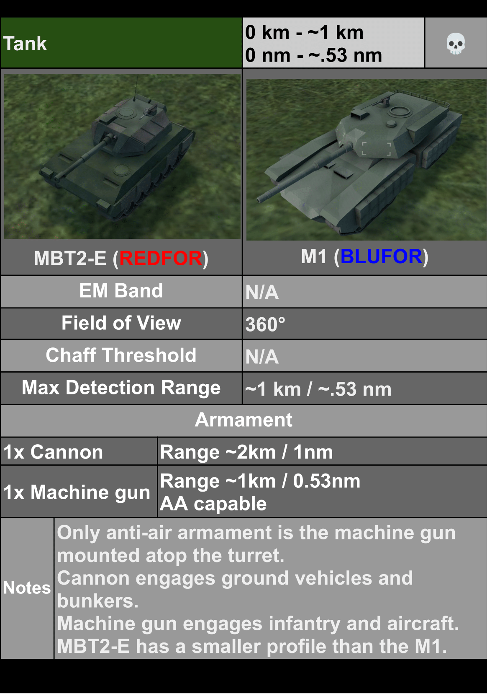{ loading=lazy }

- 🔫 **Lenkung:** Kanone + MG (MG flugabwehrfähig)
- 📏 **Reichweite:** Kanone ~2 km · MG ~1 km (0.53 nm)
- 💀 **Bedrohung:** 💀
- 📻 **RWR:** – · **FOV:** 360°

> Nur das MG auf dem Turm bekämpft Luftziele. Die Kanone schießt auf Fahrzeuge und Bunker. MBT2-E = REDFOR (kleineres Profil), M1 = BLUFOR.

[⬆ Zur Übersicht](#uebersicht)

### Artillerie (MPA-155 / RAT) { #artillerie-mpa-155-rat }

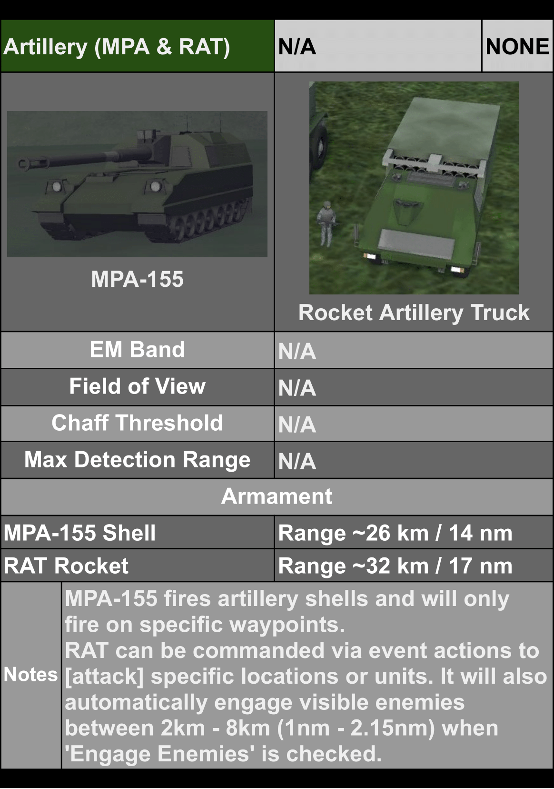{ loading=lazy }

- 🔫 **Lenkung:** – (nur Bodenziele)
- 📏 **Reichweite:** MPA-155 ~26 km · RAT ~32 km
- 💀 **Bedrohung:** keine (für Luftfahrzeuge)

> MPA-155 feuert nur auf bestimmte Wegpunkte. RAT lässt sich per Event-Action auf Orte oder Einheiten ansetzen und greift mit „Engage Enemies“ selbstständig sichtbare Gegner in 2–8 km an.

[⬆ Zur Übersicht](#uebersicht)

### Bunker A & B { #bunker-a-b }

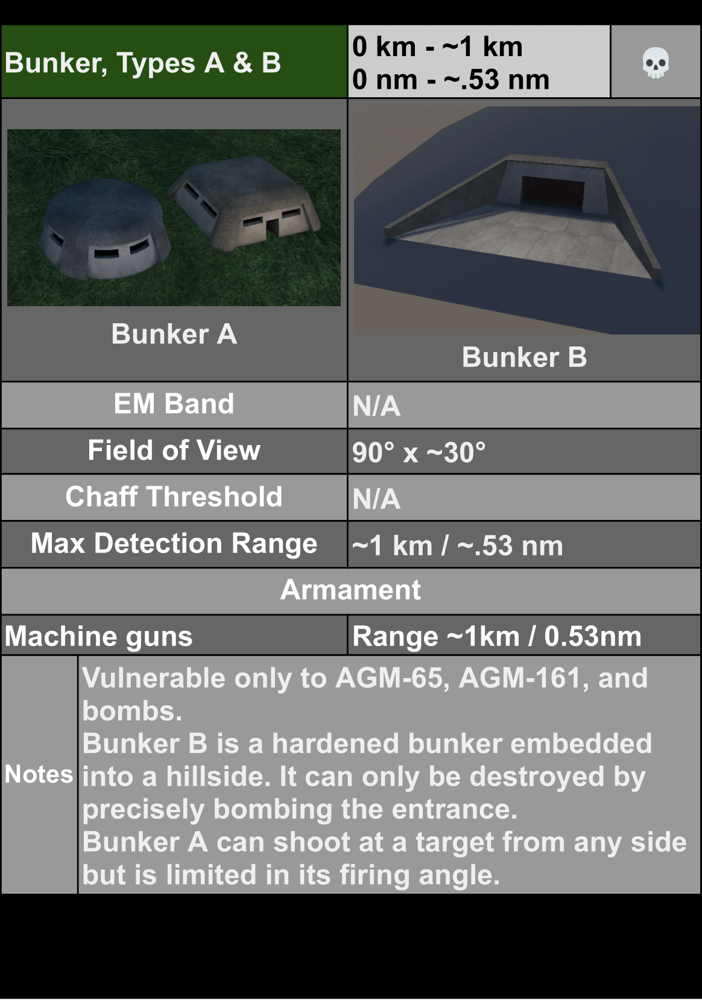{ loading=lazy }

- 🔫 **Lenkung:** Maschinengewehre
- 📏 **Reichweite:** 0–~1 km (0–~0.53 nm)
- 💀 **Bedrohung:** 💀
- 📻 **RWR:** – · **FOV:** 90°×~30°

> Nur verwundbar durch AGM-65, AGM-161 und Bomben. Bunker A schießt in alle Richtungen, aber mit begrenztem Winkel. Bunker B ist in einen Hang gebaut, nur ein präziser Bombentreffer in den Eingang zerstört ihn.

[⬆ Zur Übersicht](#uebersicht)

## Strukturen

### Missile Silo { #missile-silo }

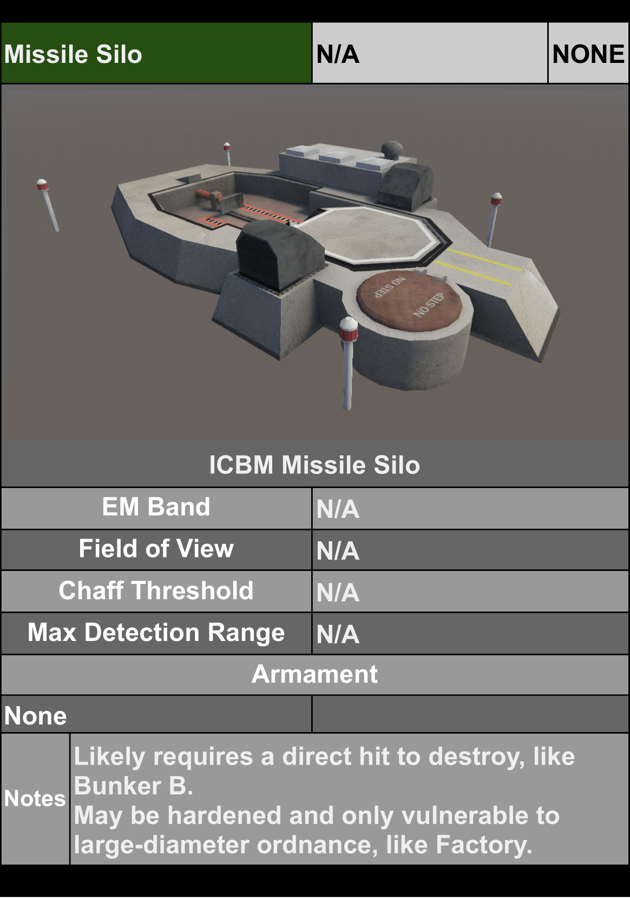{ loading=lazy }

- ➖ Unbewaffnet · keine Bedrohung

> ICBM-Silo. Braucht vermutlich einen Direkttreffer wie Bunker B und ist möglicherweise gehärtet, also nur durch große Munition zerstörbar (wie die Factory).

[⬆ Zur Übersicht](#uebersicht)

### Factory { #factory }

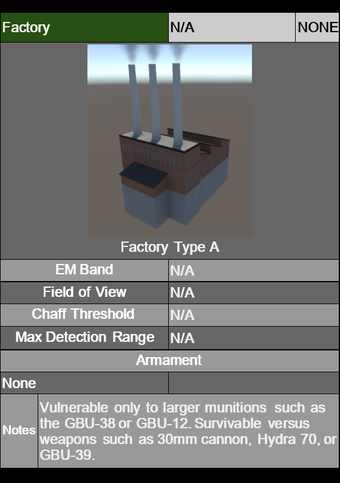{ loading=lazy }

- ➖ Unbewaffnet · keine Bedrohung

> Nur durch größere Munition wie GBU-38 oder GBU-12 zerstörbar. Übersteht 30-mm-Kanone, Hydra 70 und GBU-39.

[⬆ Zur Übersicht](#uebersicht)

### Tent, Storage { #tent-storage }

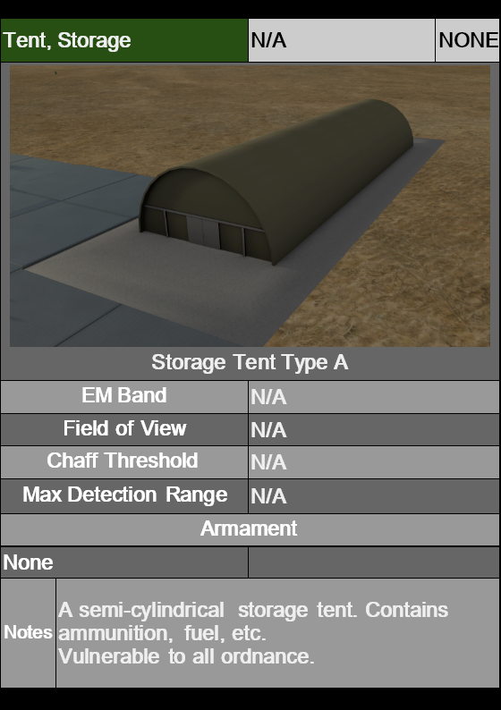{ loading=lazy }

- ➖ Unbewaffnet · keine Bedrohung

> Lagerzelt für Munition, Treibstoff usw. Durch jede Munition zerstörbar.

[⬆ Zur Übersicht](#uebersicht)

