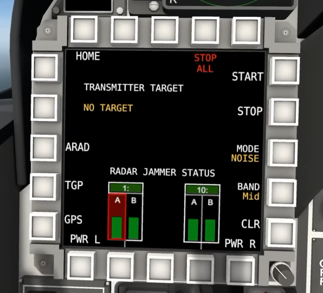

# Jamming

Jamming bedeutet, gegnerische Radare gezielt zu stören (Teil der elektronischen Kampfführung, EloKa).

!!! info "Zusammenfassung folgt"
    Eine deutsche Zusammenfassung des Videos ist in Arbeit. Bis dahin: Video und Wiki-Eintrag unten.

## Quellen

- :fontawesome-brands-youtube: [Video: Jamming & Radar Tutorial](https://www.youtube.com/watch?v=4b5b-U3Gz8U)
- :lucide-book-open: [VTOL VR Wiki: Electronic Warfare (Mechanic)](https://vtolvr.wiki.gg/wiki/Electronic_Warfare_(Mechanic)), mehr oder weniger nützlich

{ width="480" }
/// caption
Die Jammer-Seite im MFD.
///
