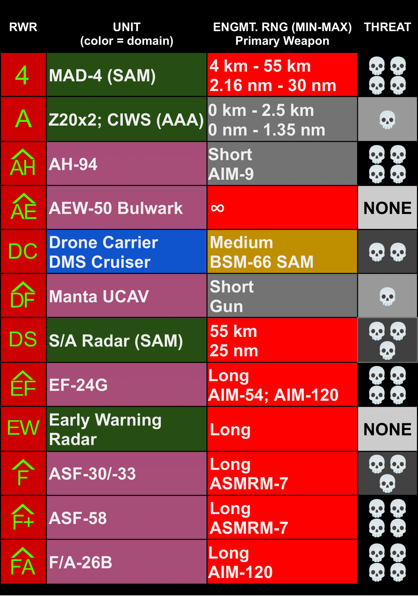
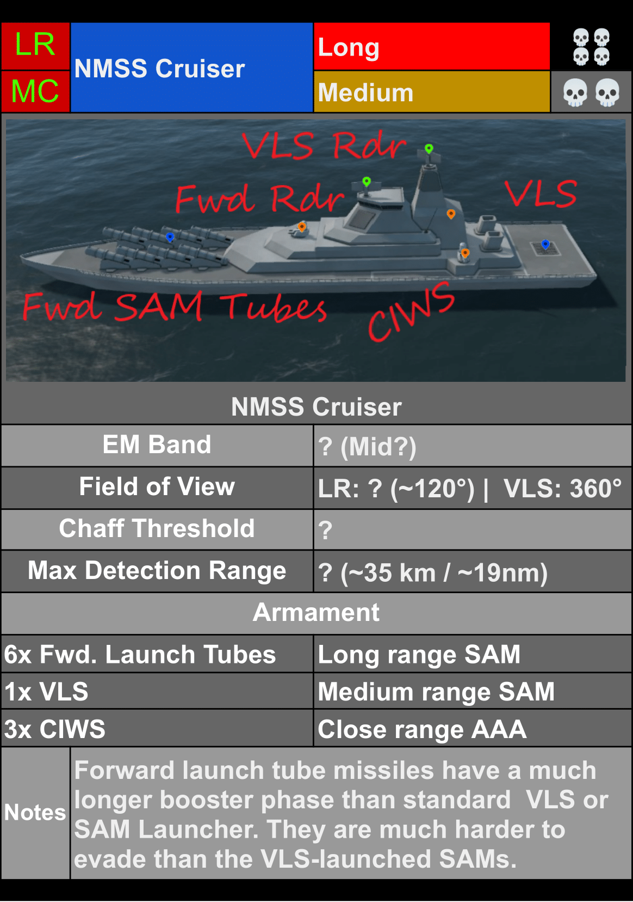
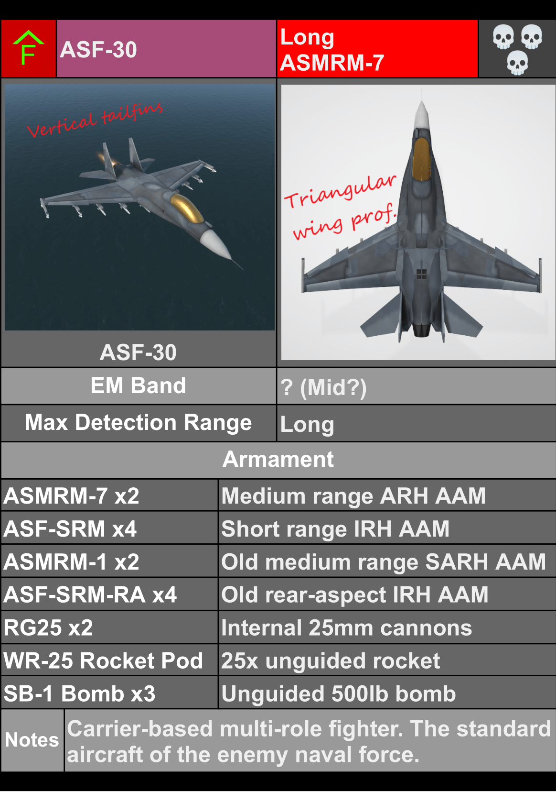
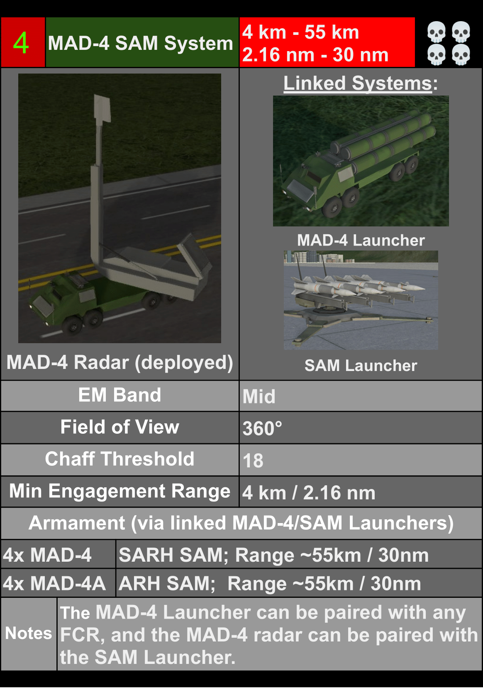
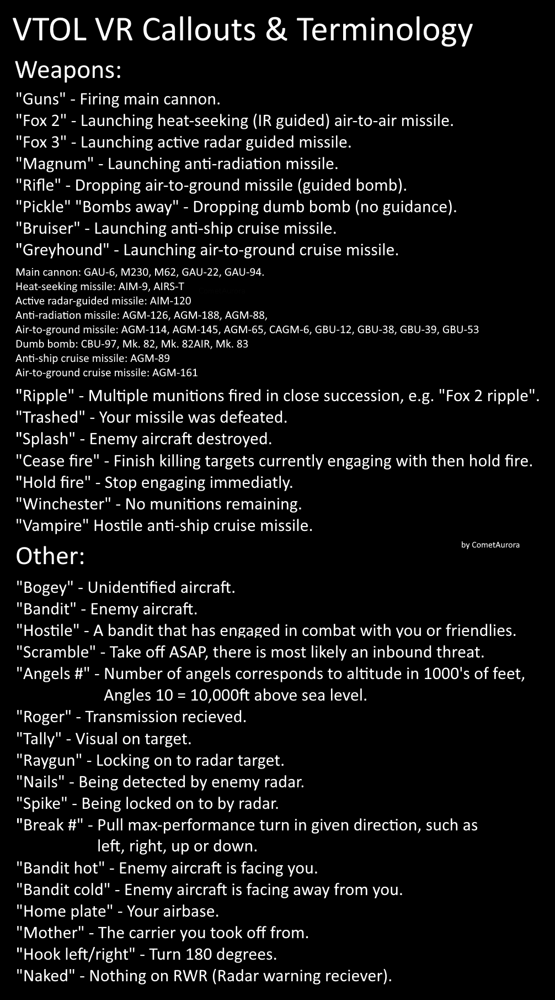

# Kneeboard-Seiten

Sehr nützliche und anschauliche Kneeboard-Seiten aus dem Projekt **[VTOL-VR-Kneeboard](https://github.com/buschwacker/VTOL-VR-Kneeboard)** von buschwacker (frei nutzbar, CC0).

!!! tip "Nutzung mit OpenKneeboard"
    Der Ersteller empfiehlt [OpenKneeboard](https://openkneeboard.com/). Das läuft unabhängig von VTOL VR und funktioniert daher auch im Vanilla-Spiel. Einfach den kompletten `PNGs`-Ordner aus dem GitHub-Projekt herunterladen und die Unterordner in OpenKneeboard als Tabs einbinden.

Das Projekt enthält unter anderem: RWR-Symbole (nach Bedrohung und alphabetisch), alle REDFOR-Einheiten (Luft, Land, See), Brevity-Codes und ein Abkürzungsverzeichnis.

## Beispiele

{ loading=lazy }

{ loading=lazy }

{ loading=lazy }

{ loading=lazy }

Alle Bodenziel-Karten findest du unter [Gegnerische Bodenziele](bodenziele.md), die Brevity-Seiten unter [Radio Brevity](radio-brevity.md).

## Callouts & Terminologie { #callouts-terminologie }

Die gängigsten und wichtigsten Callouts in VTOL VR:

{ width="560" loading=lazy }
/// caption
Quelle: Community.
///
