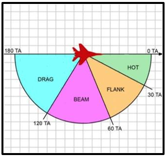
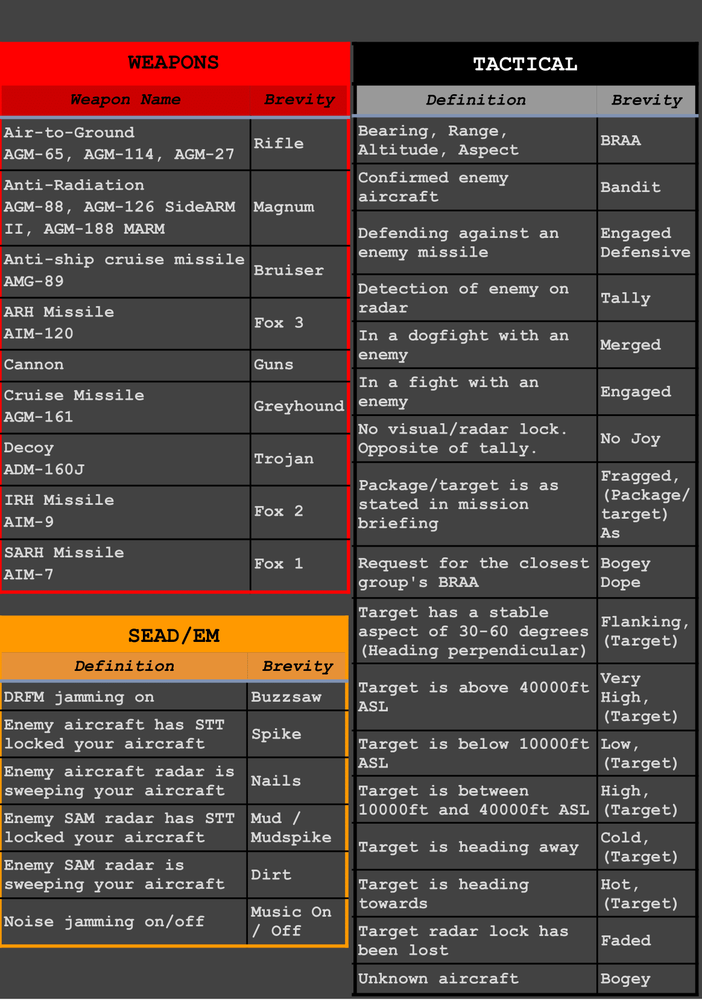
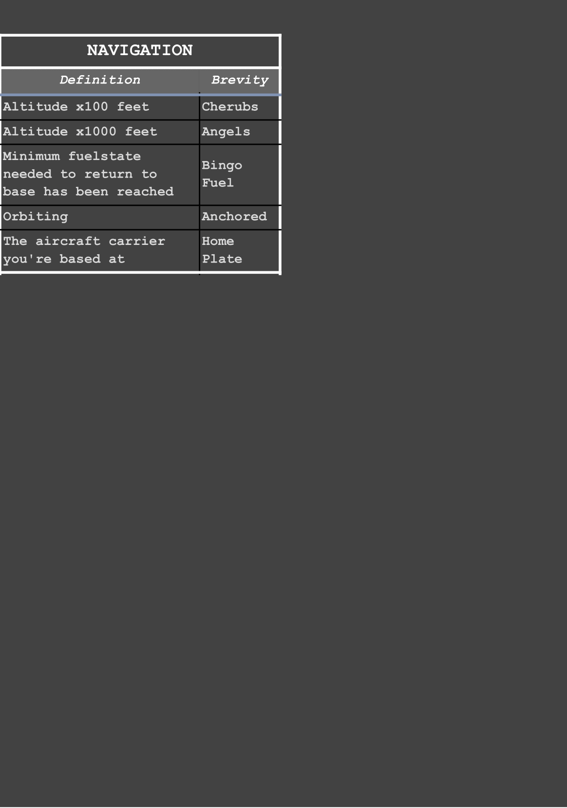

# Radio Brevity

Brevity-Codes sind kurze, eindeutige Funkbegriffe. Damit sagt man viel mit wenigen Worten.

## Ausrichtung des Ziels (Aspekt)

Im Bezug auf die Ausrichtung verwenden wir hauptsächlich:

- **HOT:** Ziel fliegt auf uns zu
- **COLD:** Ziel fliegt von uns weg
- **FLANK / FLANKING:** Ziel fliegt seitlich versetzt

{ width="400" }
/// caption
Aspektwinkel (TA = Target Aspect) von HOT über FLANK und BEAM bis DRAG.
///

## Die wichtigsten Begriffe

### Flugstatus & Ressourcen

| Begriff | Bedeutung |
| ------- | --------- |
| Winchester | Keine Munition/Waffen mehr verfügbar |
| Fence In | Kampfmodus aktivieren (Systeme auf Einsatz konfigurieren) |
| Fence Out | Kampfmodus verlassen (Systeme zurück auf Normalzustand) |

### Zielerfassung & Sensorik

| Begriff | Bedeutung |
| ------- | --------- |
| Tally | Sichtkontakt auf ein Ziel/Feind hergestellt |
| No Joy | Kein Sichtkontakt auf Ziel/Gegner |
| Raygun | Radar-Lock auf unbekanntes Flugziel (Identitätsabfrage) |
| Buddy Spike | Freundliches Radar-„Anstrahlen“ im RWR erkannt |
| Buddy Lock | Eigenes Radar hat freundliches Luftfahrzeug gelockt |

### Taktische Lage / Kampfmanöver

| Begriff | Bedeutung |
| ------- | --------- |
| Hot | Ziel bewegt sich direkt auf eigene Kräfte zu |
| Cold | Ziel entfernt sich vom Gefecht |
| Flanking | Ziel bewegt sich seitlich versetzt zur eigenen Achse |
| Defensive / Defending | Eigenes Flugzeug wird angegriffen, Ausweichmanöver aktiv |
| Merge / Merged | Luftkampf auf Sichtkontakt (Freund und Feind vermischt) |
| Pitbull | Lenkwaffe aktiv autonom (kein Radar-Support mehr nötig) |

## Kneeboard-Schnellreferenz (Englisch)

{ loading=lazy }

{ loading=lazy }

/// caption
Quelle: [VTOL-VR-Kneeboard](https://github.com/buschwacker/VTOL-VR-Kneeboard) von buschwacker (CC0).
///

Weitere Callouts: siehe [Kneeboard-Seiten](kneeboard.md#callouts-terminologie).
