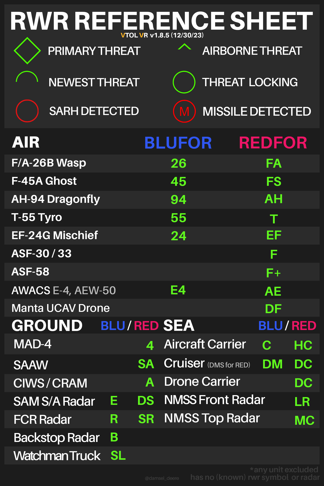
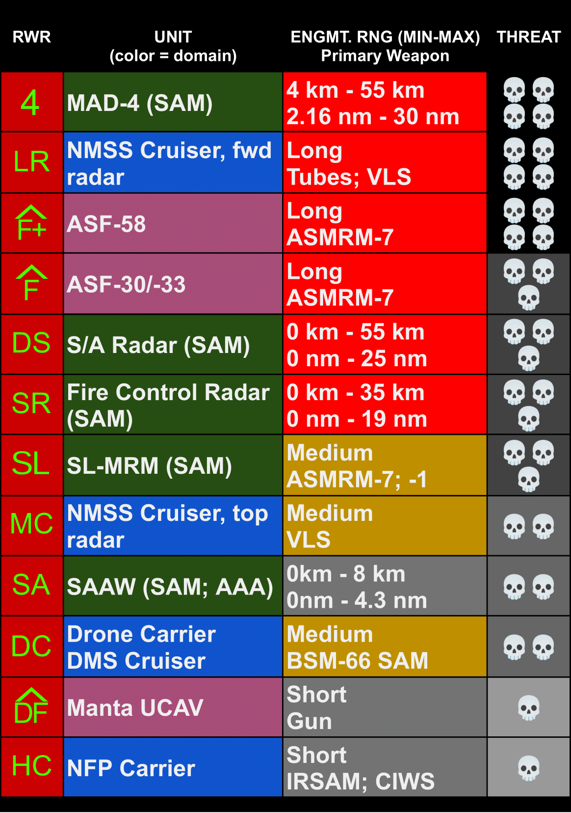
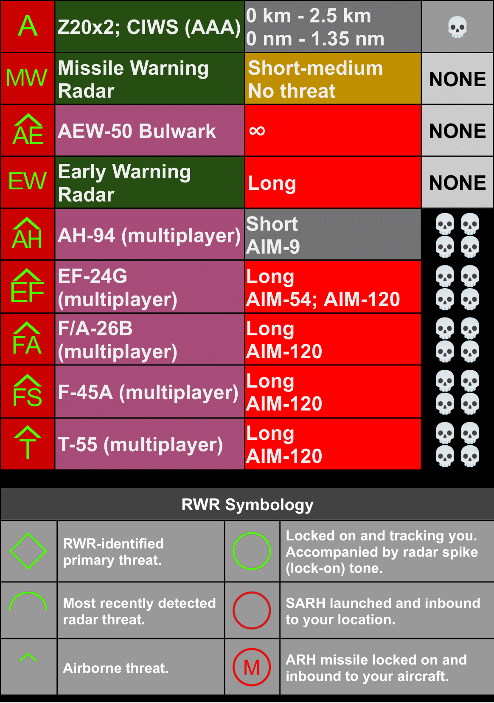

# RWR-Guide

Der **RWR** (Radar Warning Receiver) zeigt an, welche Radare dich gerade erfassen. Hier die wichtigsten Übersichten.

## Alle RWR-Symbole

{ loading=lazy }
/// caption
RWR Reference Sheet: Symbole für Luft-, Boden- und Seeziele (BLUFOR/REDFOR). Quelle: Community.
///

## Reichweiten und Gefährlichkeit

{ loading=lazy }

{ loading=lazy }

/// caption
REDFOR-Einheiten nach Bedrohung sortiert, mit Einsatzreichweite. Quelle: [VTOL-VR-Kneeboard](https://github.com/buschwacker/VTOL-VR-Kneeboard) von buschwacker (CC0).
///

Ausführliche Infos zu den Bodenzielen: [Gegnerische Bodenziele](bodenziele.md).
