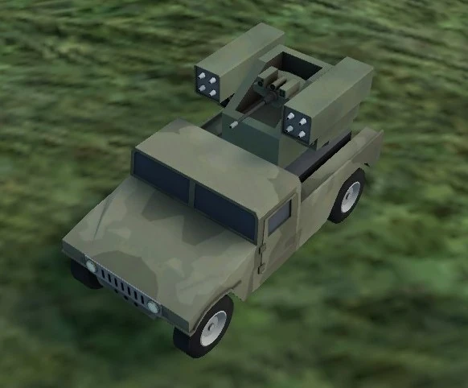

# SHORAD

**SHORAD** steht für *Short-Range Air Defense* (Nahbereichs-Flugabwehr).

- **Zweck:** Schutz von Bodentruppen und Basen vor tief fliegenden Flugzeugen und Hubschraubern.

## Gefährlichkeitsliste [RWR-Symbol]

- **[S] SAAW (Mobile Radar Anti-Air):** Höchste Gefährlichkeit. Nutzt ein aktives Suchradar und eine extrem schnell feuernde Flak. Sie zerfetzt dein Flugzeug im Nahbereich binnen Sekunden. Zeigt das Symbol S auf dem RWR.
- **[Kein RWR] C-RAM Truck:** Extrem gefährlich im Nahbereich. Schießt mit einer enormen Feuerrate direkt auf dein Flugzeug und fängt zudem deine abgefeuerten Raketen und Bomben ab. Keine RWR-Aufschaltung, aber du erhältst eine Launch Warning, sobald eine Rakete auf dich abgefeuert wird.
- **[Kein RWR] IRAPC / SRAD Truck:** Sehr tückisch. Feuern wärmesuchende Raketen. Es gibt keine RWR-Warnung beim Aufschalten, aber dein MAWS löst eine sofortige Launch Warning aus, sobald die Rakete die Schiene verlässt. Der IRAPC ist zudem gepanzert.
- **[Kein RWR] MANPADS (Infanterie):** Schwer zu entdecken. Einzelne Fußsoldaten, die sich oft in Städten oder Wäldern verstecken. Sie verursachen keine RWR-Warnung, lösen aber beim Abschuss eine Launch Warning aus. Sie sind selbst extrem verwundbar.

Details zu den einzelnen Systemen: [Gegnerische Bodenziele](bodenziele.md#mobile-kurzstrecken-flugabwehr).

## Was tun als Abwehr?

So reagierst du auf eine Launch Warning **ohne** RWR-Signal:

### 1. Sofortiges Ausweichen (Defensiv-Manöver)

- **Auskurven:** Fliege eine harte, unregelmäßige Kurve mit hoher G-Last.
- **Antrieb:** Reduziere das Gas (Throttle), um die Hitze deiner Triebwerke zu senken.

### 2. Gegenmaßnahmen (Countermeasures)

- **Flares abwerfen:** Wirf sofort mehrere Hitzetäuschkörper (Flares) aus.
- **Chaff sparen:** Düppel (Chaff) sind nutzlos, da kein Radar im Spiel ist.

### 3. Visuelle Suche

- **Blick nach unten:** Suche sofort nach der weißen Rauchspur der Rakete.
- **Optional Blick aufs MFD:** Nutze die TGP-Kamera (Targeting Pod), um den Abschussort zu lokalisieren.

{ width="480" }
/// caption
SRAD (Short-Range Air Defense Truck), gehört zu den Alliierten.
///
